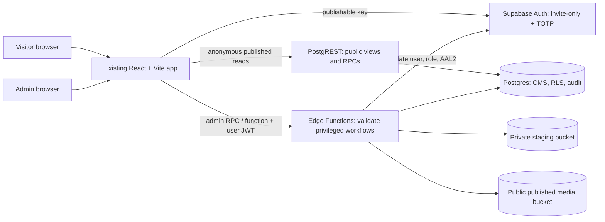
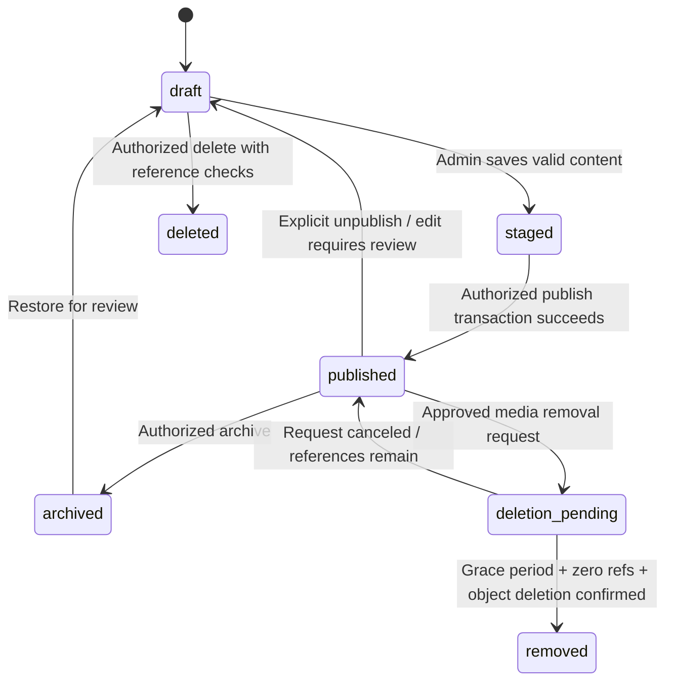
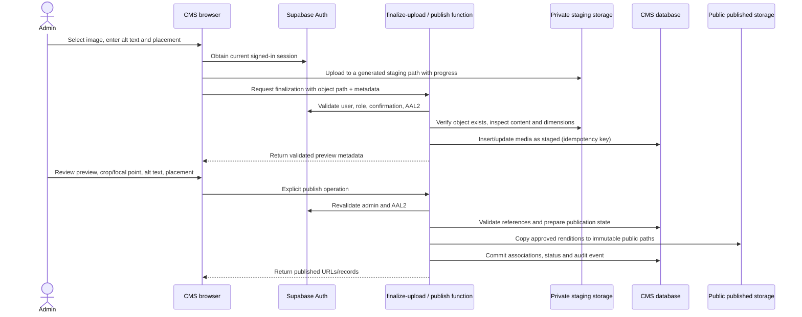
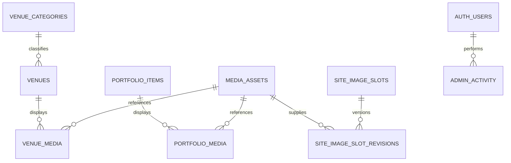

# JP Events — Supabase Integration, Authentication, Storage and CMS Plan

**Status:** Proposed — planning only; implementation has not started  
**Scope:** Establish a safe, complete, supportable Supabase-backed content system for the existing JP Events React/Vite application.  
**Current checkout:** `C:\Users\Laxman888\Downloads\subadesignsreact`  
**Supabase project shown in the supplied dashboard screenshot:** `jp-events-cms` (`ictudsiybpggphvseidh`)

## 1. Purpose and execution boundary

This document records a concrete plan for resolving the current Supabase schema errors and completing the authentication, image storage, CMS, and public content integration. It is a proposal for review. No application code, dependencies, routes, content, database objects, Auth settings, Storage settings, policies, functions, or deployment targets were changed during the audit that informed this plan.

The next phase must begin only after the owner approves this plan. Any changes to production Auth settings, bucket visibility, policies, migrations, imported/published content, SMTP, or hosting require a separate explicit implementation instruction and a verified backup/rollback path. The user previously approved a specific migration after being warned that it changes `jp-events-media` to public, but this plan still requires validating the actual live configuration and data before any new execution.

### In scope for a future implementation

- Reconcile checked-in Supabase migrations with the live project's actual schema, storage buckets, policies, authentication configuration, functions, and deployed application.
- Provide reliable public reads for published portfolio and venue content, with all writes restricted to authenticated, authorized administrators.
- Complete invitation-only admin access, secure sign-in, recovery, MFA enrollment/challenge/recovery, session handling, and role enforcement.
- Establish safe, predictable image upload, preview, publication, replacement, deletion, and orphan cleanup workflows.
- Make the existing admin CMS and home-page content use a single typed repository contract, while retaining the project's React architecture and current public routes.
- Preserve the existing enquiry/contact flow unless the owner expressly approves changing where enquiries are persisted.
- Import only verified, approved content and media, retaining rollback and publication controls.
- Define repeatable local, staging, production, accessibility, security, and mobile visual acceptance checks.

### Out of scope unless separately approved

- Redesigning the brand or making unrelated UI changes.
- Replacing Vite/React with Next.js, introducing a separate CMS backend, or changing the hosting provider.
- Enabling public sign-up, weakening RLS, exposing a service-role key in the browser, or making additional buckets public.
- Publishing demo content, stock photos, testimonials, award claims, or unverified venue facts as real JP Events content.
- Storing enquiry PII in Supabase without an approved retention, access, and privacy policy.
- Running migrations, importing data, editing live Supabase settings, deploying Edge Functions, or deploying the website as part of this planning-only task.

## 2. Executive summary

The application already contains a meaningful Supabase CMS foundation: a centralized client, repositories and hooks, CMS tables and migrations, Edge Functions for media lifecycle operations, an admin route with role/MFA checks, and public content components. The primary blocker is live-state drift: public PostgREST requests currently return `PGRST205` (“Could not find table in schema cache”) for every CMS table queried. This proves the queried tables are not available in the current REST schema cache; it does not prove whether the relations are physically absent, migrations are unapplied, or the schema cache is stale.

The supplied Supabase screenshot shows the `jp-events-media` bucket marked **PUBLIC**, with `portfolio` and `venues` folders visible. Public bucket URLs allow unauthenticated object retrieval. The screenshot does not establish the bucket's complete object inventory, policies, MIME restrictions, size limit, ownership, or whether unrelated/private objects are present. Migration `202611140003_jp_events_media_bucket.sql` changes the bucket to public and modifies its size/type settings, so it must not be blindly replayed against a bucket that may already contain data.

Read-only Auth settings report `disable_signup=false`, while the checked-in local configuration and README describe invite-only admin access. This is a real configuration mismatch. The local configuration file is not proof of remote settings. Do not change the hosted setting until a project owner confirms the intended flow and inventories existing users.

The implementation should start with owner-led live-state inventory and a staging/backup checkpoint; then reconcile schema and storage; then close Auth/RLS gaps; then complete media lifecycle and CMS reliability; then import only approved content; and finally deploy with rollback. Production remains gated until table access, admin isolation, public/private image behavior, MFA, migration idempotency, and restored-data checks pass.

## 3. Evidence and confidence labels

Use these labels when executing this plan:

- **Verified locally:** directly inspected in this checkout.
- **Verified remotely (read-only):** fetched from the hosted Supabase API using the public publishable key, or visibly shown in the supplied dashboard screenshot.
- **Inferred:** indicated by code/configuration but not confirmed against the live project.
- **Unknown:** requires project-owner Dashboard/SQL/CLI access or a production-safe read-only inventory.
- **Decision required:** an owner/product/privacy choice; do not silently assume it.

### Verified findings

| Finding | Evidence | Meaning / limitation |
|---|---|---|
| The frontend is a Vite + React + TypeScript application using Supabase JS v2. | `package.json`, `src/lib/supabaseClient.ts` | Preserve this architecture for the planned work. |
| A public publishable key and project URL are configured locally. | `.env` key names inspected without printing values; `.env` is ignored by Git | A publishable key is expected in client code; all data protection must come from RLS and safe API design. No service key was found locally. |
| `portfolio_items`, `venues`, `venue_categories`, `media_assets`, `portfolio_media`, `venue_media`, `site_image_slots`, and `admin_activity` each return `PGRST205` through public REST. | Read-only REST requests with `select=id&limit=0` | Relations are not currently resolvable by PostgREST. Determine physical schema vs cache drift before applying migrations. |
| Hosted Auth `disable_signup` is `false`. | Read-only `GET /auth/v1/settings` | Hosted signup is enabled at the time checked; app-level role guards may still prevent CMS use. This differs from the repo's invite-only intent. |
| Bucket `jp-events-media` is displayed as PUBLIC and contains visible `portfolio` and `venues` folders. | Supplied project dashboard screenshot | Public fetch is possible for objects in the bucket. Screenshot does not reveal full bucket inventory or policy contents. |
| Local `supabase/config.toml` specifies disabled signup, TOTP settings and JWT verification for selected functions. | Local config | Local config is not proof of current hosted settings. |
| The local Supabase CLI cannot run in this checkout. | `npx supabase --version` fails due to missing matching `win32-x64` binary | Use a supported CLI installation/machine after confirming provenance, or use reviewed Dashboard SQL; do not silently skip migration validation. |
| No repository test script is declared. | `package.json` | Define and run appropriate checks in the implementation phase; do not claim tests have passed now. |

### Unknowns to resolve before touching production

- Whether CMS relations exist physically, are in `public`, and are merely absent from PostgREST's schema cache.
- Which migrations are applied remotely, and whether any were edited after application.
- The complete current schema, grants, RLS policies, triggers, indexes, RPC definitions and PostgREST exposed schemas.
- All buckets, bucket settings, objects, object sizes/types, storage policies, and references to each object.
- Whether the public bucket contains private, draft, staging, client-requested-removal, or unrelated files.
- Existing Auth users, invitations, confirmed email status, app metadata roles, MFA enrollment, recovery options and active sessions.
- Whether any Edge Functions are deployed and which secrets/versions they use.
- Production website host, domains, preview deployment domains, CSP, CORS and deployment environment variables.
- Whether the external legacy images are licensed, owned, accurate, optimized, and approved for publication.
- Owner-approved retention and access policy for any enquiry submissions, activity logs, image metadata and deletion records.

## 4. Existing application and Supabase architecture audit

### Existing application areas

| Area | Current implementation | Plan |
|---|---|---|
| Supabase client | `src/lib/supabaseClient.ts` lazily initializes a browser client with URL, publishable key, PKCE, and persistent session behavior. No generated database types are used. | Keep one configured client. Generate DB types and remove unsafe casting/query duplication. Ensure no secret key can enter a `VITE_` environment variable. |
| CMS repository | `src/services/cmsRepository.ts` reads/writes portfolio, venues, categories, media and activity; includes sorting, status and relationship operations. | Make repository the typed boundary. Add bounded pagination, consistent errors, narrow selects, atomic relationship updates/RPCs, and explicit publication workflows. |
| Public hooks | `src/hooks/usePublishedContent.ts` loads public data and tracks whether content came from live CMS, cached CMS, or legacy data. A successful empty CMS response remains empty; a failed request preserves the last CMS cache or clearly identifies the legacy fallback. Venue updates use Realtime plus a 20-second polling loop. | Keep the explicit provenance behavior; validate it after live schema access is restored. Revisit Realtime/polling duplication and cleanup. |
| Data types | `src/types/cms.ts` contains manual types and unsafe casts. | Generate schema types from the reconciled DB; add derived view/RPC types and validate external inputs at boundaries. |
| Admin route | `src/pages/AdminCms.tsx` supports password sign-in, checks `app_metadata.cms_role`, performs TOTP enrollment/challenge and logout, and now includes password recovery/update UI. | Test recovery delivery and callback against the hosted Auth configuration; retain role + AAL checks, add MFA factor recovery/management and audit trail, and verify restricted invite provisioning. |
| Media upload | `src/services/mediaUploads.ts` uploads through XHR to private staging, reports progress, compresses supported images in the browser, and retains a same-session retry path. The finalizer has local checksum/path idempotency checks. No actual deployed-function or storage upload has been verified. | Preserve staging; validate compression/retry across desktop and mobile browsers, test server metadata and cleanup, and evaluate resumable uploads only if real files/network warrant it. |
| CMS media UI | `src/components/WebsiteImageEditor.tsx` supports stable whitelisted slots, upload preview, alt text and progress. Replacements still publish immediately. It has no existing-media picker, crop/focal adjustment, saved draft, explicit publish, or restore UI. | Add these only after the live schema and compatible media/revision lifecycle are reconciled; keep the current public slot active until an approved publish succeeds. |
| Home/public content | `src/components/home/HomeEditorialSections.tsx`, `HomeHero.tsx`, `Services.tsx` and related components combine Supabase content with static copy and legacy images. Social wall uses portfolio rows/fallback. | Keep editorial content in current app architecture; use stable CMS placement/order and explicit data provenance. Add responsive optimized renditions and purposeful empty/error states. |
| Contact and enquiries | `src/components/Contact.tsx` sends through EmailJS and opens WhatsApp. | Preserve. Optionally add Supabase persistence only after consent, retention, privacy, spam controls and access model are approved. |
| Edge Functions | `_shared/auth.ts`, `finalize-upload`, `publish-content`, `request-media-deletion`, `cleanup-orphan-media`, `replace-site-image`. | Audit deployed versions and secrets. Harden idempotency, compensating cleanup, MIME/content validation and observability before production rollout. |
| Legacy import | `scripts/import-legacy-cms.mjs` creates external-reference content, reportedly 12 portfolio and 9 venue rows, without uploading files. Some records have empty alt text, byte size zero, demo-like claims and no social-wall ordering. | Do not execute as-is. Curate/verify content and image rights; generate a reviewed import manifest with explicit draft state; upload owned/approved assets through the supported pipeline. |
| Tests | No package test command found. | Add test coverage as a later implementation deliverable; this audit did not run tests. |

### Key data and reliability issues found in code

1. **REST schema blocker:** all queried CMS tables are unavailable by name through PostgREST at the moment. The error is not safely fixed by suppressing it or rendering legacy data indefinitely.
2. **Public/private media split:** use the existing public `jp-events-media` bucket as the published object store and create only private `cms-staging`. The pending base migration was corrected to avoid creating a redundant public `cms-published` bucket. Site image slots still store raw paths rather than media relations, so usage/deletion accounting is incomplete.
3. **Storage/database non-atomicity:** publication copies an object to a public bucket before the database's publication step. Failure can leave exposed but unreferenced objects. Replacement can make an object public before the site slot is saved. PostgreSQL and Storage cannot be committed as one transaction; implement an idempotent state machine and compensation.
4. **Relationship replacement is multi-step:** current delete-then-insert can leave an item without its media relation after a partial failure. Sorting does many parallel updates without a single transaction.
5. **Public query breadth:** broad `select('*')` and joined `media_assets(*)` can expose unnecessary columns through public reads if policies permit row visibility. Prefer explicit public views and narrow column lists.
6. **Publishing bypass risk:** administrators may have table-level update rights capable of changing status directly instead of going through the publish RPC. Verify actual grants/policies, then constrain publication state transitions to approved database functions.
7. **Orphan cleanup is incomplete:** cleanup is limited to registered `cleanup_pending` media after seven days, checks portfolio/venue relations, and has no evident schedule. It does not fully account for site slots or all storage paths.
8. **Metadata and image checks:** the upload pipeline validates image types, sizes and dimensions and strips selected EXIF data, but is not a full image re-encoder or malware scanner. Make security claims match actual checks.
9. **Legacy data is not authoritative:** sample testimonials, review counts, award claims, venue capacities and external images must be reviewed before they can be published as facts.
10. **Auth lifecycle gaps:** a local password-recovery/update UI now handles the recovery event, but invitation delivery, redirect allowlist, password update, MFA recovery/management and the complete flow have not been tested against the hosted Auth project. Do not report hosted authentication as verified.

## 5. Target architecture

Preserve the current Vite/React application and Supabase services. The browser uses only the publishable key, accesses public read surfaces under RLS, and invokes narrowly scoped authenticated RPCs/Edge Functions for privileged transitions. Admin authorization is verified on the server using the Supabase Auth user, trusted app metadata, and AAL2 where required.



### Target invariants

- No service-role/secret key in client code, browser storage, Git, logs, build artifacts, or public environment variables.
- Anonymous visitors can read only deliberately published, safe public views and public media.
- Admin reads/writes require authenticated user, trusted admin role and AAL2 for privileged CMS mutations.
- Auth role is set only by trusted owner-controlled provisioning; never by a client-editable user profile field.
- Drafts, staging files and deletion-pending objects stay inaccessible to anonymous users.
- Public publication is an explicit operation with validation, audit record and idempotency; direct row updates cannot bypass it.
- Every published media object has a traceable `media_assets` record and known references/placements.
- Object deletion waits for an explicit request, grace period, reference check and recoverability requirements.
- CMS content errors are observable to administrators and do not masquerade as successful live content.
- Public page rendering has a deliberate loading, empty, stale, and error state; legacy fallback is clearly identified and never silently claims to be current CMS content.

## 6. Database model and CMS contract

First reconcile the following existing migration-defined relations with the live project. This is a target contract, not a claim that these exact definitions exist remotely today.

### Content relations

| Relation | Responsibility | Public exposure |
|---|---|---|
| `portfolio_items` | Wedding/story record: slug, title, short description, category, event date/location where approved, cover reference, status, publication timestamp, order, created/updated metadata. | Published columns through a safe view only. Do not expose admin notes or internal audit metadata. |
| `venues` | Venue profile: slug, title, description, category, location, capacity, amenities, pricing/contact fields only when owner-approved, cover reference, status/order. | Published safe columns through a view only. Avoid publishing private sales or operational fields. |
| `venue_categories` | Controlled categories and ordering for venue filters and CMS forms. | Active public labels/order only. |
| `media_assets` | Canonical image metadata: bucket/path, ownership/status, MIME, bytes, dimensions, content hash, alt text, focal position, uploader, review/publication/deletion timestamps. | Safe published media metadata only; never expose uploader IDs, hashes if unnecessary, or deletion internals publicly. |
| `portfolio_media` | Ordered media association for portfolio stories; role/cover/sequence/caption. | Published associations only. |
| `venue_media` | Ordered media association for venues; role/cover/sequence/caption. | Published associations only. |
| `site_image_slots` | Stable key for selected site placements, media reference/path, alt text/focal position, active flag and audit metadata. | Active public placement via safe view. Require actual media FK or equivalent reference integrity. |
| `admin_activity` | Security/operational audit of admin actions. | Admin-only. Avoid storing secrets or unnecessary personal data. |
| `social_wall_sort_order` / social wall fields | Determines approved portfolio image placement and row/order in three-row social wall. | Published item/order only. Define deterministic fallback and prevent duplicate/empty item loops. |

### Recommended integrity and publication changes

- Use UUID primary keys, stable unique slugs, explicit `draft | published | archived` status, timestamps and controlled order fields. Avoid accepting arbitrary status transitions from the browser.
- Add foreign keys for all media references, unique slot keys, uniqueness for `(story_id, media_id, role)` where appropriate, nonnegative order/byte/dimension checks, and valid focal-point bounds.
- Prefer explicit `published_portfolio`, `published_venues`, `published_media`, and active image-slot views with fixed columns over direct anonymous access to base tables.
- Grant anonymous `SELECT` only on the safe views, not broad base tables. Check function `SECURITY DEFINER` search paths and execute grants.
- Use database functions for publication and relationship replacement. A single transaction should validate content and media status, update publication fields, set references/order, and append an audit event.
- Keep user-owned fields separate from admin-owned fields. `cms_role` is trusted `app_metadata`, never user-editable `user_metadata`.
- Normalize reusable categories and image relations. Avoid storing duplicate full public URLs where bucket + object path can generate the URL consistently.
- For site slots, add a foreign key to `media_assets` (or a dedicated, constrained representation) so usage, replacement and deletion checks see every placement.
- Review indexes for published status/order, slug lookup, active slots and relationship ordering. Add pagination and deterministic secondary sort keys.
- Generate `Database` TypeScript types from the final remote schema and consume typed generated select/insert/update/RPC contracts.
- Validate imported strings, URLs, enums, dimensions, lengths and structured metadata in the UI and again on the server/database boundary.

### Publication state machine



Media object state and CMS content state must be related but distinct. An image can be uploaded and reviewed before any story is published; publishing a story must not accidentally expose other media from the same bucket.

## 7. Row-level security and authorization matrix

The exact SQL must be generated from the live inventory and reviewed in a staging project. The matrix below states intended behavior; actual migration policy names and role grants are to be verified.

| Resource | Anonymous visitor | Authenticated non-admin | Admin with AAL1 | Admin with AAL2 / trusted function |
|---|---|---|---|---|
| Published portfolio/venue safe views | Select published/active columns | Same | Same | Same |
| Draft/unpublished content | No access | No access | No access unless explicitly granted for a low-risk read | Read/edit according to admin policy |
| Base content tables | No direct access or only least-privilege safe select if views cannot serve requirement | No access | No privileged mutation | Narrow admin operations; publication through RPC/function |
| Categories | Active public category projection | Same | Read all/edit via approved CMS operation | Manage categories, audited |
| Private staging storage | No list/read/write | No access | No direct privileged write if workflow requires AAL2 | Upload/read through authorized workflow; function validates ownership/path |
| Published media storage | Read public objects only | Same | Read public objects | Write/copy/delete via validated function; no arbitrary bucket-wide delete |
| Admin activity | No access | No access | No access | Read/append according to least privilege; never update/delete normal records |
| Site image slots | Active safe projection only | Same | No mutation | Update through validated operation; publish/replace is audited |
| Auth user/role administration | None | Self-service allowed recovery only | No role grants | Owner-controlled invitation/role provisioning, separate from ordinary CMS editor |

### RLS/authorization checks before release

- Confirm RLS enabled on every exposed base table and all relevant Storage objects.
- Enumerate policies and grants from the live database/storage; test anonymous, regular authenticated, admin AAL1 and admin AAL2 separately.
- Verify policies compare trusted `auth.jwt()` app metadata (or a controlled role table) and do not trust user metadata, request parameters or client-provided email.
- Verify admin function checks current user with `auth.getUser()` and enforces email confirmation and AAL2 where specified.
- Restrict publication and deletion to explicit RPC/Edge Function routes; remove direct table privilege paths that permit status escalation.
- Test `SECURITY DEFINER` functions with fixed safe `search_path`, validated arguments, minimal returned columns and explicit `EXECUTE` grants.
- Deny bucket listing where the UI does not need it; scope object write/read/delete by bucket, path, ownership/status and authenticated admin.
- Check unauthenticated access using real public key against draft rows, staging objects, logs, hidden metadata and unapproved media.
- Ensure logs/errors do not contain JWTs, signed URLs, email tokens, service secrets, full PII or image payloads.

## 8. Authentication and admin access

### Intended model

- Invite-only admin accounts; no public sign-up.
- Owner/bootstrap operator creates/invites the initial administrator from the trusted Supabase Dashboard or a reviewed one-time server-side process.
- Assign `app_metadata.cms_role=admin` only through trusted service/admin APIs. Never put service credentials in the client.
- Require confirmed email and TOTP MFA for admin operations; use AAL2 checks on sensitive server-side operations, not only UI route guards.
- Keep access tokens short-lived according to supported Supabase settings; rely on refresh tokens securely and handle expired/revoked sessions.
- Provide a password reset flow that uses approved production SMTP, uses redirect URLs restricted to owned domains, and never reveals whether an email account exists.
- Provide MFA enrollment, challenge, factor removal/replacement, recovery codes/process, and a separately audited owner recovery procedure. Avoid locking the sole owner out.
- Log out on explicit action and handle revoked/deleted accounts; avoid logging tokens or retaining secrets in localStorage beyond the Supabase SDK's configured session behavior.

### Resolution of current mismatch

Hosted `disable_signup=false` was observed, while local `supabase/config.toml` and README expect invite-only. Before changing hosted Auth:

1. Owner inventories existing users, invitations and current project access.
2. Confirm whether any non-admin/public user flow intentionally depends on signup. This application has not been found to need public visitor accounts.
3. Confirm the initial owner/admin is recoverable and MFA/recovery route works.
4. Test in a staging project, then disable public signup remotely and verify the Dashboard invitation flow remains available.
5. Verify allowlisted redirect URLs and remove unused origins.
6. Recheck sign-up denial and admin invitation login using clean browser profiles.

### Email and account recovery

Supabase's default email service is for limited testing, not production delivery. Configure a verified custom SMTP provider, sender domain/DNS, delivery monitoring and rate limits before relying on password recovery/invitations. Test invitation, verification, reset, expired link, wrong-domain redirect, MFA challenge, factor recovery and account removal. The owner must decide the recovery contact/backup admin procedure.

## 9. Storage architecture and media operations

### Critical current storage condition

The supplied screenshot shows `jp-events-media` marked PUBLIC. Public means objects can be fetched by anyone who has an object URL; it is not a policy that only allows published objects. Therefore this bucket is acceptable for public media only if every object in it is intended for public exposure. Paths such as `portfolio/` and `venues/` are organization folders, not privacy boundaries. Do not upload drafts/private/client-sensitive images to this public bucket.

The migration that makes this bucket public also changes size limit/content type configuration. Before any migration or policy change, inventory the existing bucket in the Dashboard/API with owner privileges, export object paths/metadata, verify backup/restore access, and classify every object. If the bucket contains a mixture of public and private assets, keep it private and create/use a separate public-published bucket after migration planning. Do not simply flip it private if live public pages depend on direct URLs; that breaks current images.

### Target bucket roles

| Bucket | Visibility | Purpose | Object lifecycle |
|---|---|---|---|
| `cms-staging` | Private | Newly uploaded/unreviewed originals, replacement candidates | Admin/function access only; short-lived, cleanup scheduled only after reference/status check |
| `jp-events-media` or a newly named published bucket | Public only if inventory is entirely approved for public use | Optimized approved final images referenced by published content/site placements | Public reads; writes, copies and deletes limited to validated server-side operations |
| Optional private archive | Private, only if owner approves the operational cost | Retain removed originals for a defined recovery period | No anonymous access; lifecycle and retention documented |

Bucket names, object path strategy, and whether to reuse or replace the current public bucket are decisions after the live inventory, not predetermined migration actions.

### Path and image strategy

- Use immutable, collision-resistant paths, e.g. `portfolio/{content-uuid}/{media-uuid}.{webp}` and `venues/{venue-uuid}/{media-uuid}.{webp}`; avoid overwriting live URLs in place.
- Separate staging from published paths/buckets; do not rely on a folder prefix to make objects in a public bucket private.
- Store the canonical `bucket_id` and `storage_path` in `media_assets`; derive public URLs through one helper. Preserve external URLs only for reviewed assets with an owner and licensing/source record.
- Generate web-ready responsive renditions (e.g. card, medium, full; modern format plus a safe fallback as supported by pipeline) and use `srcset`/sizes, lazy-loading below the fold, explicit dimensions and appropriate `object-position`.
- For the hero/venue carousel, provide a properly sized high-quality initial asset and avoid downloading every full-size image on mobile. Use poster/placeholder/blur only if generated from the actual approved asset.
- Keep alt text meaningful and editorial. Decorative images use empty alt; informative event images describe the moment without guessing identities.
- Validate extension, declared content type, actual file signature, byte size, decoded format, width/height, pixel count, and server-generated path. Re-encode to remove unwanted metadata where technically supported; reject SVG unless sanitized/explicitly required.
- Enforce quotas at both client and server boundaries. Existing implementation uses 10 MiB, 6000 px, 36 MP checks according to source inspection; verify these match the remote bucket and the actual decoder/library before preserving them.
- Consider resumable TUS uploads for files larger than 6 MB or unreliable mobile networks only after measuring upload failure rates; do not add a dependency before demonstrating the need.
- Supabase image transformations are unavailable on the Free plan per current plan docs; generate renditions before upload or approve a paid plan/other image CDN if transformations become a requirement.

### Upload, preview, publish and replace flow



Because object storage and Postgres do not share a transaction, the actual implementation needs a recoverable state machine, operation idempotency key, safe retry semantics, and compensating cleanup if any step fails. A public copy must not be considered published until its database references are committed; if final commit fails, remove the unreferenced public copy promptly or flag a deterministic cleanup record. All retries must recognize an already completed operation.

### Replacement and deletion

- Replacement creates a new immutable object and keeps the old image active until the CMS publish transaction succeeds. Then mark old media superseded and queue cleanup only after references are checked.
- A site image-slot update must pass the same review/publication path and write the `media_assets` reference plus slot metadata consistently. Direct public upload from the current `replace-site-image` function must be reviewed for early exposure.
- Deletion is a two-step request/confirm or equivalent; block deletion when referenced by published portfolio/venue/slot records unless the same transaction replaces those references.
- Use a configurable grace period and reference recheck immediately before removal. Include all relations and slots, not only portfolio/venue references.
- Schedule cleanup explicitly using supported Supabase scheduling (e.g. Cron/pg_cron or an external scheduled function) only after checking plan availability and operational ownership. Alert on failed jobs and provide a dry-run report.
- Never run a broad bucket purge. Produce a deletion manifest, path count/size summary, and backup/recovery point; owner approves large/bulk cleanup separately.

## 10. Public website and content behavior

- Public pages query only published views and media records through a typed repository. Add limits/cursors, explicit ordering and image fields.
- Keep static editorial copy in the app until a concrete CMS editing need exists; model only content that administrators should genuinely manage.
- Home page data sections: hero image slots, venue showcase, portfolio/story carousel, social wall rows/order, and any approved static-to-CMS copy. A content section should not disappear silently when a migration/schema/network error occurs.
- Distinguish loading, no published content, cached/stale fallback, and real query failure. Show admin-only diagnostics with actionable error identifiers. Public visitors should receive polished fallback content with no raw SQL/API error.
- Preserve the social wall's three mobile-first rows, but ensure server ordering is explicit and manageable. Avoid infinite duplicated arrays when few images exist; avoid downloading large originals; provide touch swipe and reduced-motion behavior as planned in the UI implementation plan.
- Home hero and venue/portfolio components should use fixed aspect ratios/sizes to reduce layout shift and avoid image scaling that creates blank gray gaps. Preload only the true LCP hero asset.
- The current fallback content includes external stock-image URLs and possibly unverified venue/testimonial/award claims. Use fallback only as approved design content or remove it during a reviewed content migration; never display invented specifics as real customer outcomes.
- Keep contact form delivery via EmailJS/WhatsApp. If adding a `contact_enquiries` table is approved later, use server-side spam/rate limiting, minimal PII, explicit privacy notice/consent, narrow admin access, deletion/retention schedule, and email delivery failure tracking.

## 11. Operational and security controls

### Secrets and environments

- Maintain separate Supabase projects for local/staging and production when practical. Never run exploratory migrations against production.
- Use `.env.local`/host secrets management; commit only `.env.example` with placeholders. Check Git history and build artifacts for accidentally committed keys.
- `VITE_*` variables are public by design. Only Supabase URL and publishable key may be exposed. Service-role/secret keys stay in Edge Function secrets or a trusted server environment.
- Use separate function secrets and redirect URL allowlists per environment. Rotate any key found in Git, browser output, logs or shared screenshots.
- Ensure CORS allowlists include the actual production and necessary preview origins; source inspection showed default function CORS ports centered on 5173 while project history used 5174, so validate real development and production origins. Do not wildcard credentials-enabled endpoints.
- Set reasonable CSP, referrer policy, HSTS and image origin allowlists at the actual host once identified.

### Observability and backups

- Before a production migration: create a verified database backup/PITR checkpoint according to plan availability; export schema, policies, bucket inventory and relevant object manifests. Verify restore procedure, not merely backup existence.
- Record migration version, checksum, execution time, operator, environment and post-check results. Apply only reviewed forward migrations; use compensating migration/restore for destructive changes.
- Monitor PostgREST errors, Edge Function errors/latency, Auth delivery/MFA events, Storage upload failures and cleanup backlog without logging credentials/PII.
- Add alert thresholds for broken public assets, elevated `PGRST` errors, repeated upload failures, failed publishing and orphan count/bytes.
- Keep admin activity logs append-only for sensitive operations and define retention/export. Avoid logging image bytes, passwords, tokens, signed URLs or contact message content.

## 12. Phased implementation plan and gates

### Phase 0 — Owner inventory, staging and recovery (blocker)

1. Identify the actual production deployment host/domain and current frontend environment variables (names only; secret values remain hidden).
2. Verify project ref and ensure the intended project is `ictudsiybpggphvseidh` before any command.
3. Obtain a read-only inventory from an authorized owner: migration ledger, schema, policies/grants, functions, Auth users/settings, bucket settings/policies, object listings and sizes.
4. Classify every object in `jp-events-media` as public approved / draft-private / unknown / delete-pending. Resolve unknown objects before changing visibility.
5. Establish a staging Supabase project or isolated branch with representative non-sensitive data, and confirm restore/rollback access.
6. Confirm invite-only policy, admin identities, role assignment, MFA/recovery owner and production SMTP provider.
7. Verify source/static content and image usage rights. Prepare a reviewed import manifest; do not run the existing import script.

**Gate:** No migration, policy, bucket visibility, user, function secret or content change until project identity, inventory, backup and owner decisions are documented.

### Phase 1 — Reconcile schema and migration state

1. Install/use a supported, checksum-verified Supabase CLI version on an approved machine; the current Windows checkout's `npx supabase` invocation is unavailable.
2. Link to the exact staging project and pull/compare schema/migration history using read-only commands first.
3. Compare all checked-in migration files with the remote migration ledger and actual catalog. Determine whether missing REST relations are absent, in a different schema, unexposed, or only schema-cache stale.
4. Do not replay migrations by filename assumption. For every unapplied migration, inspect effects, dependencies and data impact. For already applied migrations, compare checksum and avoid editing history.
5. Write additive, idempotent repair migrations for genuine missing schema only. If objects exist and cache is stale, refresh PostgREST schema cache using the documented supported method and verify behavior.
6. Add preflight assertions and postflight queries for table presence, constraints, views, grants, RLS, functions and indexes.
7. Regenerate TypeScript DB types from the final staging schema; update typed repository in the implementation phase.

**Gate:** All public reads return only intentional published fields; anonymous tests cannot query draft/private data; admin functions enforce intended checks.

### Phase 2 — Storage and upload lifecycle

1. Inventory `jp-events-media` completely and decide whether to retain public visibility, migrate approved assets to a new public bucket, or keep current bucket private with signed URLs (decision depends on public website caching/UX requirements).
2. Preserve existing live object URLs during a transition or update all references atomically; no blind bucket toggle.
3. Verify/adjust allowed MIME types, maximum size, policy scope and write route against actual image pipeline limits.
4. Test staging upload, finalize, duplicate retry, invalid MIME, mismatched signature, oversized file, pathological dimensions, network disconnect, expired session, and cleanup.
5. Add media usage accounting covering portfolio, venues and site slots. Dry-run orphan reports before any deletion.
6. Harden publish/replace operations with idempotency, compensation, immutable destination names, audit events and failure recovery.
7. Add scheduled cleanup only after owner confirms grace period, retention and supported scheduling mechanism.

**Gate:** Drafts/staging are inaccessible anonymously; approved published images are fetchable; retry/replacement cannot corrupt a live reference; deletion cannot remove a referenced object.

### Phase 3 — Authentication, recovery and CMS authorization

1. Reconcile the invite-only intent with hosted Auth, where `disable_signup=false` was observed (signup is currently enabled). After user inventory and staging verification, disable public signup if the owner confirms.
2. Verify invitation/confirmed email flow and trusted admin metadata provisioning.
3. Build complete sign-in, password recovery, TOTP enrollment/challenge/removal/recovery, logout, expired-session, and access-denied UX.
4. Enforce role and AAL2 in server-side functions and database policies; UI route guard is only a usability layer.
5. Configure and validate custom SMTP and redirect allowlists. Test safe reset links and delivery throttling.
6. Verify owner/backup admin recovery before disabling any currently working authentication route.

**Gate:** Admin-only operation matrix passes for anonymous, authenticated non-admin, admin AAL1 and admin AAL2. Invite-only signup is verified in production only after owner authorization.

### Phase 4 — Typed CMS and admin workflow

1. Replace manual/unsafe data casts with generated database types and typed repository methods.
2. Use specific column selections and public views. Add pagination, deterministic sort, data validation and clear loading/empty/error states.
3. Make save, publish, unpublish, archive, relationship replacement and reorder atomic/idempotent where possible.
4. Add existing-media selection, preview, alt text, focal positioning and placement scope; stage replacements before publish.
5. Preserve draft-on-edit behavior or explicitly agree on another editorial workflow. Provide a visible preview and publish confirmation.
6. Record audit events for sign-in-sensitive admin actions, content changes, publication, media replacement/deletion and role changes where supported.

**Gate:** CMS tasks work with keyboard and touch, errors are recoverable, and every published content item has valid approved media/alt text and stable URLs.

### Phase 5 — Approved content migration

1. Prepare a row-by-row manifest with slug, accurate copy, verified venue specifications, rights/source for images, alt text, target status and intended home/social-wall ordering.
2. Separate content facts from design placeholders. Delete or retain sample testimonials/review metrics/awards only according to owner evidence.
3. Upload owned/licensed images through staging pipeline; do not rely on external image URLs for durable production CMS content.
4. Import first as draft and compare counts, references, dimensions, file sizes and rendered thumbnails in staging.
5. Obtain owner content approval; publish selected records through CMS workflow. Verify all public pages and fallback behavior.
6. Keep an export/manifest to reverse mistaken import or publication without deleting source files.

**Gate:** No unverified claims, stock images without licensing/approval, broken URLs, zero-byte fake metadata, or inaccessible hero assets.

### Phase 6 — Frontend integration and performance

1. Remove stale fallback behavior only after verified CMS live reads are available; retain a deliberately chosen offline/empty state.
2. Wire home sections and admin screens to typed repositories and stable view contracts.
3. Use responsive derivatives, lazy loading below fold, explicit dimensions, LCP image prioritization, and bounded fetches.
4. Confirm mobile carousel and social-wall interaction has native horizontal touch behavior without page-level horizontal overflow.
5. Keep EmailJS/WhatsApp enquiry delivery unchanged. If persistence is added, treat as a separate reviewed privacy feature.
6. Ensure sitemap/SEO reflects actual published routes and hosting behavior; confirm host supports SPA fallback and dynamic/static sitemap requirements before adding routing infrastructure.

**Gate:** No content section silently reports fallback as live. Lighthouse/performance and screenshot review meet agreed budgets on mid-range Android emulation and real-device spot check where available.

### Phase 7 — Verification and launch

1. Apply migrations to staging, deploy functions to staging, and run the full acceptance checklist in §13.
2. Test migration from a clean schema and upgrade from a copy of current production. Test restoration from backup.
3. Review SQL diff, RLS policy matrix, Edge Function diff, secret list, bucket visibility and object inventory with project owner.
4. Run independent security review for Auth, RLS, Storage, function validation, XSS/HTML, rate limits and file upload.
5. Deploy production in a low-risk window with a known migration/function/frontend sequence and rollback owner on call.
6. Re-run health checks and watch metrics. Roll back frontend/function behavior or restore DB from the agreed recovery point if critical gates fail.

**Gate:** Owner signs off on staging screenshots, policy tests, content manifest, backup restore evidence, SMTP and rollback steps.

### Phase 8 — Maintenance

- Review project usage, database/storage growth, bandwidth, function invocation count, Auth deliveries and cleanup backlog monthly.
- Review policies and admin list after staff changes; remove access promptly and test revoked session behavior.
- Keep migrations in Git, review changes, and never make undocumented Dashboard-only schema changes.
- Re-run media reference/orphan dry-run and verify scheduled jobs and backup restore at an agreed cadence.
- Update generated DB types and integration checks whenever schema changes.

## 13. Acceptance checklist (planned; none run as part of this plan)

### Database and schema

- [ ] Live schema/migration inventory recorded; all migration IDs and checksums reconciled.
- [ ] Clean database migration and production-copy upgrade both succeed in staging.
- [ ] Repeating migrations/preflight does not create duplicates or reset existing bucket data.
- [ ] PostgREST returns expected safe views and RPCs; no `PGRST205` for supported public content paths.
- [ ] Generated TypeScript DB types compile with the application.
- [ ] Foreign keys, uniqueness, check constraints, ordering and publication invariants are verified.
- [ ] Direct table writes cannot bypass publish/unpublish/archive lifecycle.

### Authentication and authorization

- [ ] Public signup policy matches owner-approved invite-only decision.
- [ ] Invitation, email confirmation, sign-in, password recovery, logout and expired-session handling work.
- [ ] TOTP enrollment, challenge, AAL2 operation requirement, factor replacement and owner recovery work.
- [ ] Anonymous and non-admin users cannot read drafts, logs, private metadata or staging files.
- [ ] Admin AAL1 cannot perform actions requiring AAL2; admin AAL2 can perform intended actions only.
- [ ] No user-editable metadata can grant an admin role.
- [ ] SMTP, redirect allowlist and email rate limiting are production tested.

### Storage and media

- [ ] Full existing bucket/object inventory is reconciled to the approved media manifest.
- [ ] Public bucket contains only content explicitly approved for public retrieval.
- [ ] Staging bucket and unapproved objects are not anonymously retrievable or listable.
- [ ] MIME/signature mismatch, SVG, oversized bytes, extreme dimensions, corrupt files and unauthenticated uploads are rejected.
- [ ] Valid mobile upload reports progress and recovers safely from failure/retry.
- [ ] New uploads are previewed before publication; existing published images remain available during replacement.
- [ ] Failed finalization/publication is idempotently retriable and does not leave untracked public objects.
- [ ] Referenced images cannot be removed; cleanup dry-run includes site slots and every media relation.
- [ ] Alt text, responsive sizes, intrinsic dimensions, focal points and file sizes are checked.

### CMS and frontend

- [ ] Admin can create/edit/reorder/publish/unpublish/archive approved portfolio and venues; each transition is audited.
- [ ] Relationship replacement/reorder cannot lose all media after a partial failure.
- [ ] Homepage carousel, hero, social wall and venue section consume intended published records with explicit order.
- [ ] Empty/loading/error/stale states are deliberate; no raw backend errors leak to visitors.
- [ ] No demo reviews, award statements, capacities or venue claims appear unless verified and approved.
- [ ] Image failures do not create large layout gaps; images have correct aspect ratio and mobile rendition.
- [ ] Contact email and WhatsApp behavior remain intact; no new PII collection occurs without approval.
- [ ] Keyboard accessibility, accessible names/alt text, focus behavior, contrast, touch targets and reduced motion pass.
- [ ] Mobile screenshots reviewed at 360px, 390px, and 430px; desktop at 1440px.
- [ ] No horizontal page overflow; mobile swipe remains native and does not trap vertical scrolling.

### Operational readiness

- [ ] Database restore from backup has been demonstrated in staging.
- [ ] Function secrets are set outside source; no secret appears in client bundle, Git, logs or error reports.
- [ ] Production host, HTTPS, CORS, CSP, redirect URLs and SPA route fallback are verified.
- [ ] Edge Function versions and scheduled cleanup are deployed and observable.
- [ ] Monitoring and owner alert contacts exist for content/API/image outage.
- [ ] Rollback runbook and operator access are tested.

## 14. Risk register

| Risk | Impact | Mitigation / decision |
|---|---|---|
| Blindly applying migration `202611140003` makes an existing bucket public or changes its limits/types. | Draft/client/unrelated images become fetchable; existing uploads may be impacted. | Inventory bucket and policies first; classify every object. Use separate private staging/public approved buckets where necessary. No blind `db push`. |
| `PGRST205` is treated as proof that all schema is absent. | Duplicate/conflicting migrations or destructive repairs. | Inspect migration ledger, catalog, exposed schemas and cache. Repair only evidenced cause. |
| Signup remains enabled unintentionally. | Unwanted user accounts/abuse; role and cost confusion. | Owner confirms user inventory and signup intent; disable only after recovery/invite validation. |
| Public reads select base tables or broad columns. | Draft/admin/internal metadata exposure. | Safe views with fixed columns, narrow grants, explicit RLS tests. |
| Client can update content status directly. | Unreviewed content publication or bypass of audit/validation. | Restrict grants/policies and route state transitions through secure DB function/Edge Function. |
| Storage and database publication partially succeed. | Broken content or publicly exposed orphan files. | Idempotent state machine, immutable paths, compensation, reconciliation jobs and alerting. |
| Cleanup misses site-slot or future references. | Live images disappear or orphan storage grows. | Canonical media FK, complete relation inventory, pre-delete reference recheck and dry-run. |
| `service_role` leaks into Vite environment. | Complete RLS bypass and project-wide data exposure. | Secret scanning, environment allowlist, deployment bundle inspection, immediate key rotation if found. |
| External/demo content is treated as authoritative. | False advertising, rights claims, client trust/legal issues. | Owner verifies facts, photos, consent/rights, testimonials and claims in signed import manifest. |
| Auth recovery is incomplete for only admin. | CMS lockout or unsafe manual account recovery. | Test backup owner/admin and recovery before restricting signup or changing factors. |
| Default SMTP limits or poor deliverability block invite/reset. | Admins cannot access CMS reliably. | Production custom SMTP, sender DNS, rate-limit/deliverability checks. |
| Free-tier quotas/pausing disrupt production. | Site outage, upload/transform limitations, capped bandwidth. | Review current plan and usage, establish owner budget/SLO and upgrade/backup strategy as needed. |
| Storage originals and variants exceed free quota. | Upload failure or service-plan upgrade pressure. | Size budgets, responsive compressed renditions, lifecycle policy, storage monitoring. |
| No test command or current integration test coverage. | Regressions discovered only in production. | Add focused unit/integration/E2E and policy tests in implementation phase; establish staging gates. |
| Unknown hosting platform conflicts with SPA routes/redirects/CORS. | Broken deep links, reset URLs or function requests. | Identify hosting provider/domain in Phase 0; configure and verify host-specific behavior. |

## 15. Free-plan and capacity planning

Plan limits and availability can change; verify current billing Dashboard and official documentation immediately before launch. Current Supabase Free documentation lists limited database/storage/bandwidth/function/Realtime quotas and excludes image transformations. Do not rely on cached numbers as a production capacity guarantee.

Operational implications for this site:

- Compress and resize original photographs before publishing; wedding photography can exhaust storage/bandwidth quickly if large originals are used as carousel images.
- Use small mobile renditions, lazy loading and only preload the visible LCP image. Avoid rendering dozens of full-resolution files at once.
- Track storage bytes and cached/uncached egress, including social-wall/carousel images.
- Track Realtime connections/events; remove duplicate polling if it creates unnecessary requests, while retaining an intentional freshness strategy.
- Confirm whether project inactivity pausing applies to the chosen plan and define monitoring/owner response.
- Budget a paid tier or external CDN/transform service if predictable production uptime, image transforms, higher bandwidth, scheduled jobs or point-in-time recovery are required.
- Never leave customer-facing production availability dependent on a free-tier feature assumption that has not been verified.

## 16. Owner-run operational steps (future implementation only)

These steps are deliberately not performed as part of this plan:

1. Open the exact Supabase project shown in the screenshot and confirm project reference in Dashboard before running SQL/CLI.
2. Export current schema, migration history, policies, Auth settings/user list, function deployments, buckets and object manifest. Store exports securely.
3. Confirm a verified database backup and demonstrate restore in staging.
4. Review the entire `jp-events-media` inventory and decide public/private separation. Identify any unknown assets; do not make them public by default.
5. Install a supported Supabase CLI for the operator platform; authenticate with the owner's account only in their environment. Confirm the checkout's CLI issue is resolved without committing credentials.
6. Link staging first, inspect diffs, generate a migration preview, apply to staging and run acceptance checks.
7. Configure SMTP and invite/MFA recovery in staging. Confirm designated owner/admin can recover access.
8. Review content manifest, image rights, alt text and all factual claims. Approve selected rows for publication.
9. Only after all gates pass, schedule a separately approved production rollout with a named operator, backup checkpoint, migration diff, function deploy list, frontend build, health checks and rollback window.

## 17. Research and primary references

Prefer official Supabase documentation for service behavior and re-check it when implementation begins.

### Supabase primary documentation

- [API keys: publishable and secret keys](https://supabase.com/docs/guides/getting-started/api-keys) — confirms what may be placed in a browser and why RLS is essential.
- [React with Supabase tutorial](https://supabase.com/docs/guides/getting-started/tutorials/with-react) — baseline client integration patterns; adapt to this existing Vite architecture.
- [Row Level Security](https://supabase.com/docs/guides/database/postgres/row-level-security) — design and test least-privilege policies.
- [Generate TypeScript types](https://supabase.com/docs/guides/api/rest/generating-types) — replace hand-maintained `as unknown as` data contracts after schema reconciliation.
- [Auth users and invitations](https://supabase.com/docs/guides/auth/users) — owner-controlled admin invitations and user lifecycle.
- [TOTP MFA](https://supabase.com/docs/guides/auth/auth-mfa/totp) — factor enrollment/challenge and assurance-level checks.
- [Password-based Auth and recovery](https://supabase.com/docs/guides/auth/passwords) — reset flow, redirects and account recovery.
- [Custom SMTP](https://supabase.com/docs/guides/auth/auth-smtp) — production email delivery; the built-in sender is limited/testing-focused.
- [Storage access control](https://supabase.com/docs/guides/storage/security/access-control) — Storage policies and object access rules.
- [Bucket fundamentals](https://supabase.com/docs/guides/storage/buckets/fundamentals) — public bucket behavior and limits.
- [Resumable uploads](https://supabase.com/docs/guides/storage/uploads/resumable-uploads) — consider TUS for larger or unreliable-network uploads after measurement.
- [Storage file limits](https://supabase.com/docs/guides/storage/uploads/file-limits) — align client/server checks with bucket and project limits.
- [Image transformations](https://supabase.com/docs/guides/storage/serving/image-transformations) — current feature/plan limitations and image-serving options.
- [Storage bandwidth](https://supabase.com/docs/guides/storage/serving/bandwidth) — monitor cached/uncached delivery impact.
- [Supabase billing and plan quotas](https://supabase.com/docs/guides/platform/billing-on-supabase) and [pricing](https://supabase.com/pricing) — re-check quotas, pauses and feature availability before launch.
- [Production checklist](https://supabase.com/docs/guides/deployment/going-into-prod) — production readiness review.
- [Database migrations](https://supabase.com/docs/guides/deployment/database-migrations) — source-controlled migration workflow and remote state.
- [Supabase CLI](https://supabase.com/docs/guides/local-development/cli/getting-started) — supported local CLI installation/link workflow.

### Open-source patterns to inspect (not wholesale replacements)

- [Official Supabase React user-management example](https://github.com/supabase/supabase/tree/master/examples/user-management/react-user-management) — inspect practical client Auth/session patterns; adapt the security model to invite-only admin and MFA.
- [Payload CMS](https://github.com/payloadcms/payload) — study editorial preview and media organization patterns only. It is a separate CMS/backend and should not be introduced without a clear need because the project already uses Supabase and React.
- [Directus](https://github.com/directus/directus) — study content modeling/admin workflow concepts only; it would duplicate current Supabase-backed CMS responsibilities.
- [Strapi](https://github.com/strapi/strapi) — study content lifecycle concepts only; it introduces another backend and operational surface, so it is not part of the proposed architecture.

## 18. Approval checkpoint

The initial audit and planning document do not authorize production writes by themselves. The current user request authorizes read-only diagnostics; production SQL, Auth changes, Storage changes, function deployment, publishing or deletion still require live inventory, backup/rollback evidence and approval at the specific write boundary. Sections 19 onward record the latest diagnostics and implementation-level plan.

## 19. Live read-only diagnostic update — 2026-11-24

This section supersedes assumptions that could not be verified in the earlier repository-only audit. Checks used the `VITE_SUPABASE_URL` and publishable key from the local `.env`; the key value was not printed or shared. Project ref `ictudsiybpggphvseidh` matches the project ref shown in the supplied Dashboard screenshot.

| Check | Result | Conclusion |
|---|---|---|
| `GET /auth/v1/settings` | HTTP 200; `disable_signup=false` | Hosted Auth currently allows new signups. This differs from `supabase/config.toml` (`enable_signup=false`) and the invite-only product intent. |
| Public REST `select=id&limit=0` for all eight CMS relations | HTTP 404 with `PGRST205` for `portfolio_items`, `venues`, `venue_categories`, `media_assets`, `portfolio_media`, `venue_media`, `site_image_slots`, and `admin_activity` | None of these relations is currently resolvable through the project's public PostgREST schema cache. This alone cannot distinguish missing relations, non-exposed schema, missing grants, or stale cache. |
| Storage bucket metadata requests for `cms-staging`, `jp-events-media` | HTTP 400 with Storage `NoSuchBucket` using the publishable key | **Not conclusive.** Bucket metadata calls require permission on `storage.buckets`; this client cannot inventory buckets. The supplied screenshot showed `jp-events-media` as public at capture time. Reconcile current bucket state in Dashboard/owner SQL. |
| `OPTIONS` preflight for `finalize-upload`, `publish-content`, `request-media-deletion`, `cleanup-orphan-media`, `replace-site-image` | HTTP 404 `NOT_FOUND` for each function route | These functions are not reachable as deployed at the configured project/function names at the time checked. The checked-in function source is not proof of deployment. |
| Authenticated CLI `functions list --remote` | Empty function list | No Edge Functions are deployed to production; local source does not prove upload, publish, deletion, or replacement endpoints work. |
| Remote migration ledger, catalog, RLS, Auth users, Storage object inventory, and function secrets | Not readable with the browser-safe publishable key; no owner Dashboard/SQL connector or authenticated CLI is available in this checkout | Owner-side SQL Editor/Dashboard inspection is required. No administrator password or secret should be shared in chat. |
| Local Supabase CLI | v3.2.0 works after installing its matching Windows x64 package locally with `--no-save`; owner authenticated and `projects list` shows the correct active ref; `supabase link --project-ref ictudsiybpggphvseidh` succeeded. `migration list --remote` shows all five local timestamps with blank remote versions. The first concurrent dry-run failed with duplicate `cli_login_postgres` role creation; a sequential dry run succeeded both before and after local migration edits. | All five local migrations are pending according to CLI history; the final dry run listed the same five and no seed/role files. No CMS migrations were applied. The duplicate-role failure came from running two login-role operations concurrently; sequential read-only CLI commands succeeded afterward. CLI warns it ignores local config key `auth.mfa.totp.max_enrolled_factors`; this is not evidence about hosted MFA. |
| Admin login, invitation, MFA, upload, publish, restore, and deletion | Not run | No authenticated admin account/session is available, and live schema/function paths are unresolved. Do not claim these flows work until exercised end-to-end. |

### Current diagnosis

The frontend and authenticated CLI both target the project ref in the owner screenshot. The live browser-safe API returned `PGRST205` for all eight tables and `404 NOT_FOUND` for all five expected function routes. The owner-provided catalog query confirms the CMS relations/functions/policies are absent from `public`, the migration ledger is absent, and only `jp-events-media` exists. Sequential CLI inspection lists all five local migrations as pending and a successful dry run confirms only those five files would be pushed. No migrations have been applied.

No CMS migration, Storage object, Auth setting, bucket configuration, or Edge Function was changed. An initial concurrent CLI dry-run failed while initializing the temporary database login role; rerunning the dry run sequentially succeeded and listed all five pending files without applying them. Local application code has since been updated: password recovery UI was added; image uploads now optimize supported photos client-side and preserve a same-session retry path; the local `finalize-upload` function gained same-path/checksum recovery checks; and published-content hooks now distinguish live CMS, cached CMS, and legacy fallback so a successful empty CMS response is not overwritten. The home/portfolio/venue sections no longer present raw database errors to visitors. A local production build succeeds, and targeted ESLint passes for the touched files. These checks do not verify live authentication, upload, or persistence. The browser tool could not access local browser tabs for this chat, so no Dashboard state was read through the UI. The current public-key request to `/auth/v1/settings` did verify the signup setting described above. The CLI executable is available and authenticated/linked to `ictudsiybpggphvseidh`.

After the live inventory, the pending local migrations were adjusted to create only private `cms-staging` and publish through the already-existing `jp-events-media`; the unused public `cms-published` bucket and its policy were removed before any production application. `publish-content` now consistently recognizes `jp-events-media` as the published bucket. The final sequential dry run still lists exactly the five expected migration files. No Docker executable or disposable staging project is available in this checkout, so a local database replay was not run; the production catalog comparison shows the CMS objects are absent and the `jp-events-media` rows are empty placeholders by metadata.

### Owner-provided Dashboard catalog result

The owner ran the §24 read-only query and supplied its complete JSON output. It establishes this current production baseline:

| Area | Observed result | Interpretation |
|---|---|---|
| CMS relations in `public` | `relations: []` and `columns: []` for all eight requested names: `portfolio_items`, `venues`, `venue_categories`, `media_assets`, `portfolio_media`, `venue_media`, `site_image_slots`, `admin_activity` | These CMS tables are physically absent from `public`; this explains `PGRST205` more directly than a schema-cache-only diagnosis. |
| CMS functions and policies | `cms_functions: []`; `policies: []` for the requested public relations and `storage.objects` | The local CMS security functions, RLS policies, and upload policies are not installed in the inspected schema. |
| Migration tracking | `migration_ledger_relation: null`, `migration_ledger_columns: []`; the follow-up query errors because `supabase_migrations.schema_migrations` is absent | There is no Supabase CLI migration ledger at the standard location. This does not prove whether someone previously used another migration tool or applied SQL manually. Do not create/repair history by hand. The supported CLI can initialize its history table while applying reviewed migrations; its first `db push` can also apply every pending local migration, so inspect the dry run and file set first. |
| PostgREST setting | `postgrest_exposed_schemas: null` | This `current_setting(..., true)` result is inconclusive about exposed schemas; it is not evidence to change API configuration. Since the relations themselves are absent, relation creation is the immediate prerequisite. |
| Storage buckets | Only `jp-events-media` is present; it is `public=true`, has a 10 MiB limit, and `allowed_mime_types=null`. `cms-staging` is absent. The local migrations no longer create `cms-published`. | Preserve the existing public bucket. A public bucket serves any object to anyone with its URL; migration `003` keeps its visibility/size and restricts its MIME setting to JPEG/PNG/WebP. |
| Existing Storage objects | Two object rows total, one under each top-level prefix `portfolio` and `venues`; neither is a trailing-slash folder marker. Both report `size=0` and `mimetype=application/octet-stream`; image-MIME objects = 0, nonempty objects = 0, total reported bytes = 0. | The bucket contains no usable image according to Storage metadata. Do not assume these placeholders are images or overwrite/delete them. The migrations leave them unchanged; a later owner-approved upload must be tested. |
| Storage RLS/grants | `storage.buckets` and `storage.objects` have RLS enabled. The diagnostic reports broad table grants to `anon`/`authenticated`, but no policies for the queried `storage.objects` relation. | Grants alone do not bypass RLS. Supabase requires `storage.objects` policies for operations such as authenticated upload/delete; public object GET is separately served without that policy check. Do not grant broader access; install only reviewed, bucket/path-scoped policies. |

The second migration-ledger query was therefore not applicable and its “relation does not exist” result is expected. Supabase’s current documentation says its CLI creates the migration history table on first `db push`, but that command can apply all pending migrations; the reviewed dry run and migration files must be checked before any production push. See [Supabase migration deployment and history](https://supabase.com/docs/guides/deployment/database-migrations), [missing migration table guidance](https://supabase.com/kb/troubleshooting/error-relation-supabase_migrationsschema_migrations-does-not-exist-a787d6), [Storage bucket access model](https://supabase.com/docs/guides/storage/buckets/fundamentals), and [Storage RLS policy behavior](https://supabase.com/docs/guides/storage/security/access-control).

### Read-only Storage metadata check (completed)

Before migration `202611140003_jp_events_media_bucket.sql` changes the existing bucket's MIME restrictions, this read-only summary was run to return prefix, count, reported byte sizes and MIME types without returning object paths:

```sql
SELECT
  bucket_id,
  split_part(name, '/', 1) AS top_level_prefix,
  count(*) AS object_count,
  count(*) FILTER (WHERE (metadata ->> 'size') ~ '^[0-9]+$') AS objects_with_numeric_size,
  sum(CASE WHEN (metadata ->> 'size') ~ '^[0-9]+$'
           THEN (metadata ->> 'size')::bigint ELSE 0 END) AS reported_bytes,
  array_agg(DISTINCT metadata ->> 'mimetype') FILTER (WHERE metadata ->> 'mimetype' IS NOT NULL) AS mime_types
FROM storage.objects
WHERE bucket_id = 'jp-events-media'
GROUP BY bucket_id, split_part(name, '/', 1)
ORDER BY top_level_prefix;
```

The summary was run via the authenticated CLI in a read-only transaction. It returned two rows with numeric size `0`, MIME `application/octet-stream`, zero nonempty/image-MIME objects, and no folder-marker objects. This does not verify raw bytes or an image URL. Do not alter or delete these rows; test a later owner-approved upload end-to-end.

## 20. Exact migration inventory and no-replay decision tree

### Checked-in migration ownership

| Migration | Objects owned by the file | Special effects / replay risk |
|---|---|---|
| `202611140001_cms.sql` | `portfolio_items`, `venues`, `media_assets`, `portfolio_media`, `venue_media`, `admin_activity`; helper/audit/publish functions; base RLS policies; private `cms-staging` bucket and its policies. Published media uses the existing `jp-events-media`. | Creates named policies/triggers without idempotent guards. Its bucket `ON CONFLICT` only targets the absent `cms-staging` bucket in the current inventory. It cannot be blindly rerun against partly provisioned production. |
| `202611140002_venue_categories_pricing.sql` | `venue_categories`; category/pricing columns and index on `venues`; category policies/triggers; replacement `cms_publish_content` function. | Seeds/upserts reception-hall category; updates existing venue rows; `DROP FUNCTION IF EXISTS` then recreates the publish RPC; creates policies without duplicate-name guards. Inspect any existing data and function grants before applying. |
| `202611140003_jp_events_media_bucket.sql` | Expands the `media_assets` path constraint/read policy to recognize `jp-events-media`; creates its Storage policies. | Upserts `jp-events-media` as **public** and overwrites file-size/MIME settings. Public object fetch bypasses Storage RLS. Never apply until every existing object is classified and the owner approves the exposure/configuration. |
| `202611140004_site_image_slots.sql` | `site_image_slots`, public active-slot select and admin writes, Realtime publication membership, timestamp/audit triggers. | The slot stores `storage_path`, not a foreign key to `media_assets`; cleanup/reference checks can miss these objects. Policies/triggers are not all duplicate-safe. |
| `202611220001_social_wall_rows.sql` | `social_wall_row`, `social_wall_sort_order` columns and partial ordering index on `portfolio_items`. | Additive `IF NOT EXISTS` columns/index, but still must be reconciled against live constraint definitions before replay. |

Migration ownership of the eight queried names is: six base relations in `001`; `venue_categories` in `002`; `site_image_slots` in `004`. Social-wall rows are columns on `portfolio_items`, not a ninth table. Local migrations are evidence of intended schema only; they do not prove a single file ran remotely.

### Production reconciliation flow

1. Run the read-only SQL in §24 and inspect the migration ledger columns before selecting applied versions. Use the Dashboard project ref `ictudsiybpggphvseidh` and make sure the SQL Editor is open on that exact project.
2. Compare ledger IDs with the five local filenames. Compare actual relation/column/constraint/function/policy/bucket definitions with the files; ledger IDs alone do not prove the live schema matches the source files.
3. **If the ledger says all migrations ran and the catalog has all relations:** verify PostgREST exposed schemas/grants. Correct only the evidenced exposure/grant issue, or issue `NOTIFY pgrst, 'reload schema';` after schema correctness is confirmed. Re-query all eight REST routes before any table recreation.
4. **If a relation exists but the ledger is missing its migration ID:** do not run `db push` or replay that file. Reconcile schema/data manually in staging, repair migration history using the supported Supabase workflow, and create a small forward-only drift migration only for verified differences.
5. **If a migration ID exists but one of its relations/policies is missing:** treat it as partial/manual drift. Build an additive repair migration from the actual catalog diff; test on a clone first. Do not insert the old migration ID by hand or use `CREATE TABLE IF NOT EXISTS` to mask a mismatched definition.
6. **For the current observed baseline:** the requested CMS relations/functions/policies are absent, the migration ledger is absent, and `jp-events-media` is public with two zero-byte `application/octet-stream` objects by metadata. The authenticated CLI is linked to the correct active project. Its sequential `db push --dry-run --remote` succeeded and listed only the five reviewed local migrations, with no seed or role files. Do not push until the owner explicitly approves the write boundary. A first real push initializes migration history and applies those five files. Migration `003` retains public visibility and the existing 10 MiB limit, while restricting the previously unrestricted MIME setting to JPEG/PNG/WebP; it does not modify the two existing objects. After approval, recheck CMS REST routes and Storage settings before deploying Edge Functions or testing media.
7. **If all objects exist and REST still yields `PGRST205`:** verify `public` is in the Data API exposed schemas, grants are present for the needed roles, then reload PostgREST schema cache. If exposed-schema settings were manually overridden at the database role level, follow the documented project-specific correction; do not recreate relations.
8. At each step retain schema/ledger exports and make a forward repair rather than destructive rollback. Do not drop any table, bucket, policy, publication, or function until dependency/data impact is documented and separately approved.

The dashboard SQL Editor can be used for read-only diagnostics. For durable schema changes, prefer reviewed migration files and the supported CLI after reconciliation because direct Dashboard DDL bypasses the repository's migration ledger. See the official [migration workflow](https://supabase.com/docs/guides/deployment/database-migrations) and [PostgREST schema-cache refresh procedure](https://supabase.com/kb/troubleshooting/refresh-postgrest-schema).

## 21. Exact target schema and relationships

The existing relations remain authoritative for portfolio, venues and CMS media. Extend only after the live diff is known. A future visual-editor version history is a proposed addition; it does not exist in the current migration set.



Required relationship and column contract:

- `portfolio_items`: stable UUID and unique slug, editorial fields, status/published timestamp, deterministic order and optional social wall row/order (1–3). Only approved factual fields are rendered.
- `venues`: stable UUID and unique slug, accurate venue fields, required active `venue_categories` reference, publication status/order and pricing only if the owner has approved those facts.
- `portfolio_media` / `venue_media`: composite parent-media key, role (`cover` or `gallery`), explicit nonnegative position. Exactly one cover is required at publication. Relationship set replacement and reordering should be one validated database function/transaction, not N independent requests.
- `media_assets`: canonical UUID metadata, provider/bucket/path or reviewed external URL, MIME, actual byte size, dimensions, checksum, alt text, owner/uploader, state and timestamps. Supabase records must have a valid path in an approved bucket; deleted records must not retain a retrievable path. Validate measured values; no zero-byte placeholder for uploaded media.
- `site_image_slots`: stable unique slot key and section, current published media reference, active/alt/focal data. Replace raw `storage_path` ownership with `media_asset_id` FK once a safe data migration is designed. Preserve old slots until mapping has been exported and verified.
- Proposed `site_image_slot_revisions`: append-only version rows keyed to a slot and `media_assets`, with `draft | published | superseded` state, version sequence, `created_by`, creation/publish timestamp and audit pointer. A slot's public view points only to its current published revision. Never expose draft revisions to `anon`.
- `admin_activity`: append-only action records with actor, action, entity, time and minimized details. The security definer trigger must avoid storing sensitive text/secrets and must handle rows without a UUID `id` (e.g. junctions) without failing.
- `social_wall_row` stays on portfolio initially; ordered rows query published portfolio records joined to one approved cover/gallery media item. Add separate join table only if product needs per-image (rather than per-story) row assignment.

Prefer safe published views (`published_portfolio`, `published_venues`, `published_media`, `active_site_image_slots`) with fixed fields and narrow `anon` grants. Verify whether PostgREST supports these views with underlying RLS/security-invoker semantics as configured; do not assume a view is safe solely because its name says `published`.

## 22. File-by-file implementation roadmap

This roadmap identifies existing files and their role; it does not authorize editing them before the infrastructure findings and production boundary are cleared.

| File / area | Keep and complete | Required change after approval |
|---|---|---|
| `supabase/migrations/*.sql` | Existing five migration files and project history | Reconcile against live schema first. Add a forward-only repair migration only for catalog-proven drift. Add versioned image-slot/revision and security hardening migrations only after staging tests. Never rewrite an already-applied migration. |
| `supabase/config.toml` | Existing local signup-disabled and `verify_jwt=true` intentions | Keep JWT verification enabled for all user-facing mutating functions. Local config does not change hosted settings; deploy per-function config only after review. |
| `src/lib/supabaseClient.ts` | Publishable-key client, PKCE, token refresh and session persistence | Keep as singleton; validate env, document environment setup, ensure no secret key. Regenerate DB types and remove unsafe relation casts. |
| `src/types/cms.ts` | Existing CMS domain shapes and URL helper | Derive raw DB contracts from generated types; add explicit public view and slot-revision types; centralize bucket/path URL generation; remove permissive shape casting. |
| `src/services/cmsRepository.ts` | Existing published/admin reads, draft saves, publishing, reorder and deletion request calls | Query narrow safe views, paginate and order deterministically; use atomic RPCs for relationship replacement, status transitions and ordering; add preview/draft/revision APIs and recoverable errors. |
| `src/hooks/usePublishedContent.ts` | Existing React data hooks and fallback behavior | Track source/freshness/error explicitly. A valid published DB response always wins; legacy data is fallback only on actual infrastructure failure/empty result per agreed product rule, never overwrites valid data. Invalidate/revalidate after slot publication on other devices. |
| `src/services/mediaUploads.ts` | Magic-byte/type and decoded-dimension checks; random per-upload path; XHR progress to staging; calls `finalize-upload` | Add client-side resizing/encoding with no new library unless built-in APIs prove insufficient; support multiple-file partial failure recovery, cancellation/retry/idempotency and image decode cleanup. Server must revalidate bytes; browser metadata is advisory. |
| `src/services/siteImageSlots.ts` | Slot query and URL builder; current direct `replace-site-image` request | Convert to library selection + staged revision lifecycle; return preview URLs; save draft, publish, restore; use public immutable asset path only after publication. |
| `src/components/WebsiteImageEditor.tsx` | Global provider, auth check, authorized edit toggle, approved slot-key guard and preview dialog | Add edit toolbar only for verified admin+AAL2; existing media library picker; desktop crop controls and mobile-safe focal/position adjustment; alt text; Save draft / Publish / Restore previous; success reflected in public queries; trap focus and secure close behavior. Do not reveal controls when auth is loading/failed. |
| `src/contexts/websiteImageEditorContext.ts` | Shared edit mode, slot map, dialog and save API | Track selected media, draft/published revisions, allowed slot registry, save/publish/restore operation states and cross-tab invalidation. |
| `src/pages/AdminCms.tsx` | Current password login, trusted `app_metadata.cms_role` check, TOTP challenge/enrollment, session persistence, logout, multi-file selection/preview and CMS CRUD UI | Add recovery callback/reset screen, resend/re-invite guidance without account enumeration, MFA factor settings/recovery guidance, upload retry/partial success and media library selection. Keep admin route guard and enforce same checks server/database side. |
| `src/App.tsx` | Existing route split and global editor provider | Preserve routes and design. Keep `/admin/*` out of public chrome; only render a visual edit affordance in public route when provider confirms admin+AAL2. |
| `src/components/home/HomeHero.tsx` | Stable `home.hero.slide-01..03` placements | Keep image editor integration; use draft-published slot resolution and LCP-aware responsive media. |
| `src/components/About.tsx` | Stable `home.about.story-01..03` placements | Preserve approved layout/animations, wire published revisions and preview. |
| `src/components/Services.tsx` | Service image slots and venue cover placements | Use stable category keys; venue UUID keys remain stable, never array index. Clarify shared service imagery versus per-service media. |
| `src/components/home/HomeEditorialSections.tsx` and `src/components/ImmersiveImageRibbon.tsx` | Experience, moments, venue and ribbon image slots / carousels | Route all CMS-sourced image changes through canonical media relations/slot revisions. Prevent portfolio slot duplicates from hiding canonical album updates. |
| Other public image components (`Portfolio`, `Testimonials`, footer, blog, invitations) | Existing UI and animation behavior | Inventory actual rendered image sources and add only relevant approved stable IDs. Keep static brand decorations outside the CMS unless editors need them. Blog content requires its own schema only if owner approves it; current task does not authorize a new blog CMS. |
| `supabase/functions/_shared/auth.ts` | User-JWT validation, confirmed email, trusted admin role, AAL2, service client, CORS helpers | Align CORS allowlist to verified development/production domains; avoid relying on unverified JWT payload alone; use server `getUser`, maintain AAL2 checks, sanitize error responses and log correlation IDs only. |
| `supabase/functions/_shared/images.ts` | Shared server-side image verifier/sanitizer | Verify actual decode/re-encode behavior, resource limits, orientation/metadata, corrupt files and decompression bombs; add measured variants and consistent MIME/content length. |
| `finalize-upload` | Validated staging object -> registered media record | Add idempotency key, retry reconciliation, server-owned ownership/path, multi-file operation IDs, cleanup on registration failure and clear object visibility. |
| `publish-content` | Validates content/media, promotes staged images, calls `cms_publish_content` | Order operations as a recoverable saga; make retries safe; never update a published row before all cover/media checks; compensate public copies on DB failure; use one authoritative public bucket. |
| `replace-site-image` | Current allowlisted slot and server upload endpoint | Replace immediate-public replacement with staged revision, draft preview, publish operation, rollback-to-prior revision; tie media reference to slot and preserve previous immutable object. |
| `request-media-deletion` and `cleanup-orphan-media` | Existing soft-delete/grace-period pattern | Include site image revision and active slot refs, retain 7-day grace only after owner agreement, make cleanup scheduled/idempotent and report dry-run counts before delete. |
| `scripts/import-legacy-cms.mjs` and `src/data/legacyCmsData.ts` | Importer/fallback source only | Do not run until factual content/license manifest is owner approved. Import as draft, upload verified assets and produce a deterministic, reversible report. |
| `package.json` and test fixtures | Existing dependencies and scripts | Preserve dependency list unless an image editor/resizer need is demonstrated. Add focused test scripts and Playwright only if the existing tooling cannot cover the required E2E; do not install speculative libraries. |

## 23. Owner Dashboard actions in execution order

The first action is diagnostic only. Do not change any toggles or run a migration until the catalog results are reviewed.

1. **Open the correct project:** Supabase Dashboard → project `jp-events-cms` → confirm project reference `ictudsiybpggphvseidh` in project URL/header.
2. **Read-only catalog check:** Database → SQL Editor → New query → paste the `SELECT`-only SQL from §24 → Run. Copy the `diagnostic` JSON output. It returns catalog names, columns, constraints, grants, policies, function metadata, current Storage bucket settings and aggregate object counts/bytes (not filenames, emails or credentials).
3. **Read migration ledger:** if the JSON reports `supabase_migrations.schema_migrations` exists, run the second `SELECT` in §24 and share version/name rows. This verifies migration history; do not edit it.
4. **Read Storage dashboard state:** Storage → Files → inspect `jp-events-media` and `cms-staging` if present. Record each bucket's public/private toggle, file limit, allowed MIME types, approximate object count/size and visible prefixes. Storage → Policies: inspect the `storage.objects` policies. Do not toggle, upload, move or delete anything.
5. **Read function state:** Edge Functions → verify whether each of the five names in §19 is deployed; inspect only status/deployment version and last error summaries. Do not paste secret values or environment dumps.
6. **Read Auth state:** Authentication → Users → privately verify intended administrator account exists and is confirmed; Authentication → Settings → record signup, email confirmation, Site URL/redirect allowlist, TOTP settings and SMTP configured status. Do not share passwords, OTPs, QR codes, TOTP seeds, recovery links or user email lists in this chat.
7. Return the SQL result plus non-sensitive dashboard status. Based on this evidence, prepare a migration/file-operation diff and request explicit approval at the first production write boundary.

### Production-changing actions remain separately gated

Disabling signups, changing app metadata/roles, changing TOTP/SMTP/redirect settings, applying SQL/migrations, creating/updating buckets or policies, deploying functions, uploading/publishing/deleting real images and changing production website hosting are production changes. No such change was made. The exact write SQL/CLI sequence will be derived only after the live state and desired owner decisions are known; do not run the historical migrations wholesale or apply a guessed repair.

## 24. Read-only Supabase SQL Editor diagnostics

This first statement contains only `SELECT` operations and reads Postgres catalog/Storage metadata; it does not alter production. Run it in the exact project from §23. It intentionally does not query `auth.users` or return object paths.

```sql
WITH target_relations(schema_name, relation_name) AS (
  VALUES
    ('public', 'portfolio_items'),
    ('public', 'venues'),
    ('public', 'venue_categories'),
    ('public', 'media_assets'),
    ('public', 'portfolio_media'),
    ('public', 'venue_media'),
    ('public', 'site_image_slots'),
    ('public', 'admin_activity'),
    ('storage', 'buckets'),
    ('storage', 'objects')
),
relations AS (
  SELECT n.nspname AS schema_name, c.relname AS relation_name, c.relkind,
         c.relrowsecurity AS rls_enabled, c.relforcerowsecurity AS force_rls
  FROM pg_catalog.pg_class c
  JOIN pg_catalog.pg_namespace n ON n.oid = c.relnamespace
  JOIN target_relations t ON t.schema_name = n.nspname AND t.relation_name = c.relname
),
relevant_columns AS (
  SELECT table_schema, table_name, ordinal_position, column_name, data_type, is_nullable
  FROM information_schema.columns
  WHERE (table_schema, table_name) IN (
    ('public','portfolio_items'), ('public','venues'), ('public','venue_categories'),
    ('public','media_assets'), ('public','portfolio_media'), ('public','venue_media'),
    ('public','site_image_slots'), ('public','admin_activity')
  )
),
relevant_constraints AS (
  SELECT n.nspname AS schema_name, c.relname AS relation_name, con.conname,
         con.contype, pg_catalog.pg_get_constraintdef(con.oid, true) AS definition
  FROM pg_catalog.pg_constraint con
  JOIN pg_catalog.pg_class c ON c.oid = con.conrelid
  JOIN pg_catalog.pg_namespace n ON n.oid = c.relnamespace
  JOIN target_relations t ON t.schema_name = n.nspname AND t.relation_name = c.relname
),
relevant_policies AS (
  SELECT schemaname, tablename, policyname, permissive, roles, cmd, qual, with_check
  FROM pg_catalog.pg_policies
  WHERE (schemaname, tablename) IN (
    ('public','portfolio_items'), ('public','venues'), ('public','venue_categories'),
    ('public','media_assets'), ('public','portfolio_media'), ('public','venue_media'),
    ('public','site_image_slots'), ('public','admin_activity'), ('storage','objects')
  )
),
relevant_grants AS (
  SELECT table_schema, table_name, grantee, privilege_type
  FROM information_schema.role_table_grants
  WHERE (table_schema, table_name) IN (
    ('public','portfolio_items'), ('public','venues'), ('public','venue_categories'),
    ('public','media_assets'), ('public','portfolio_media'), ('public','venue_media'),
    ('public','site_image_slots'), ('public','admin_activity'), ('storage','objects'), ('storage','buckets')
  )
  AND grantee IN ('anon','authenticated','service_role')
),
cms_functions AS (
  SELECT n.nspname AS schema_name, p.proname AS function_name,
         pg_catalog.pg_get_function_identity_arguments(p.oid) AS arguments,
         p.prosecdef AS security_definer, p.proconfig AS function_settings,
         p.proacl AS function_acl
  FROM pg_catalog.pg_proc p
  JOIN pg_catalog.pg_namespace n ON n.oid = p.pronamespace
  WHERE n.nspname = 'public' AND left(p.proname, 4) = 'cms_'
),
storage_buckets AS (
  SELECT id, name, public, file_size_limit, allowed_mime_types
  FROM storage.buckets
),
storage_object_totals AS (
  SELECT bucket_id, split_part(name, '/', 1) AS top_level_prefix,
         count(*) AS object_count,
         sum(CASE WHEN (metadata ->> 'size') ~ '^[0-9]+$'
                  THEN (metadata ->> 'size')::bigint ELSE 0 END) AS total_bytes
  FROM storage.objects
  WHERE bucket_id IN ('cms-staging','jp-events-media')
  GROUP BY bucket_id, split_part(name, '/', 1)
),
ledger_columns AS (
  SELECT ordinal_position, column_name, data_type
  FROM information_schema.columns
  WHERE table_schema = 'supabase_migrations' AND table_name = 'schema_migrations'
),
realtime_tables AS (
  SELECT schemaname, tablename
  FROM pg_catalog.pg_publication_tables
  WHERE pubname = 'supabase_realtime'
    AND schemaname = 'public'
    AND tablename IN (
      'portfolio_items','venues','venue_categories','media_assets','site_image_slots'
    )
)
SELECT pg_catalog.jsonb_pretty(pg_catalog.jsonb_build_object(
  'database', current_database(),
  'postgrest_exposed_schemas', current_setting('pgrst.db_schemas', true),
  'migration_ledger_relation', to_regclass('supabase_migrations.schema_migrations')::text,
  'migration_ledger_columns', coalesce((SELECT jsonb_agg(to_jsonb(x) ORDER BY x.ordinal_position) FROM ledger_columns x), '[]'::jsonb),
  'relations', coalesce((SELECT jsonb_agg(to_jsonb(x) ORDER BY x.schema_name, x.relation_name) FROM relations x), '[]'::jsonb),
  'columns', coalesce((SELECT jsonb_agg(to_jsonb(x) ORDER BY x.table_schema, x.table_name, x.ordinal_position) FROM relevant_columns x), '[]'::jsonb),
  'constraints', coalesce((SELECT jsonb_agg(to_jsonb(x) ORDER BY x.schema_name, x.relation_name, x.conname) FROM relevant_constraints x), '[]'::jsonb),
  'policies', coalesce((SELECT jsonb_agg(to_jsonb(x) ORDER BY x.schemaname, x.tablename, x.policyname) FROM relevant_policies x), '[]'::jsonb),
  'grants', coalesce((SELECT jsonb_agg(to_jsonb(x) ORDER BY x.table_schema, x.table_name, x.grantee, x.privilege_type) FROM relevant_grants x), '[]'::jsonb),
  'cms_functions', coalesce((SELECT jsonb_agg(to_jsonb(x) ORDER BY x.function_name, x.arguments) FROM cms_functions x), '[]'::jsonb),
  'buckets', coalesce((SELECT jsonb_agg(to_jsonb(x) ORDER BY x.id) FROM storage_buckets x), '[]'::jsonb),
  'object_totals_by_bucket_and_prefix', coalesce((SELECT jsonb_agg(to_jsonb(x) ORDER BY x.bucket_id, x.top_level_prefix) FROM storage_object_totals x), '[]'::jsonb),
  'realtime_tables', coalesce((SELECT jsonb_agg(to_jsonb(x) ORDER BY x.tablename) FROM realtime_tables x), '[]'::jsonb)
)) AS diagnostic;
```

If `migration_ledger_relation` is non-null, run this second read-only query to return applied version/name values without dumping stored migration SQL:

```sql
SELECT to_jsonb(m) ->> 'version' AS version,
       to_jsonb(m) ->> 'name' AS name
FROM supabase_migrations.schema_migrations AS m
ORDER BY version;
```

If either query errors, stop and copy the error text; do not edit the query to add DDL. The catalog query references standard Supabase `storage.buckets`/`storage.objects`; if those schemas are unavailable, that is itself useful drift evidence.

## 25. Authentication, role and MFA operational sequence

1. Dashboard → Authentication → Users: privately verify the intended admin account exists. If not, owner invites that admin through **Add user → Send invitation**. The invitation flow must be tested with the actual configured SMTP sender. Never share the password or invitation link here.
2. Assign `cms_role=admin` in trusted `raw_app_meta_data` only. Do not set it in `user_metadata` and do not let the browser sign-up form assign it. If the Dashboard UI does not support trusted app metadata editing, use an owner-controlled one-time server-side admin provisioning procedure; its write must be reviewed and approved separately.
3. Dashboard → Authentication → Settings: verify **Allow new users to sign up** is disabled for the intended invite-only site; verify email confirmations, Site URL and exact local/production redirect URLs. Because current hosted setting is enabled, toggling it is an explicit production security change and must happen only after existing user/recovery review.
4. Dashboard → Authentication → Settings / MFA: verify TOTP enrollment and verification are enabled, and test that a verified admin signs in AAL1 then reaches AAL2 after challenge. Checked-in config requests TOTP; public settings endpoint did not expose factor enforcement details, so hosted state remains unknown.
5. Configure verified custom SMTP and sender DNS. Supabase's built-in sender is for low-volume testing and may restrict recipients/rates; test invite and reset delivery using an approved administrator mailbox.
6. The local `AdminCms.tsx` now requests recovery through `resetPasswordForEmail`, handles the `PASSWORD_RECOVERY` event and validates a new password/confirmation. Configure the hosted redirect allowlist and SMTP, then test request, email delivery, PKCE callback, expired link, password update and subsequent sign-in with an approved administrator. A local UI/build check is not proof that hosted recovery works.
7. Verify session persistence across refresh and tab close/reopen using a test admin, logout clears the session, admin routes redirect/deny properly, non-admin sessions never reach CMS data, and public visitor routes never show edit controls. Do not use or ask for test credentials in chat.

The Supabase Auth user invitation is a Dashboard/server admin action, not a browser `signUp` action. See [Auth user invitations](https://supabase.com/docs/guides/auth/users), [TOTP assurance levels](https://supabase.com/docs/guides/auth/auth-mfa/totp), and [password recovery](https://supabase.com/docs/reference/javascript/auth-resetpasswordforemail).

## 26. Storage policy and media lifecycle specification

### Bucket and policy invariant

- `cms-staging` must be private. Admin-owned uploads use the session JWT and path format already emitted by `uploadCmsImage`: `<portfolio|venues>/<content-uuid>/<auth.uid()>/<random-id>.<ext>`. The current `001` insert policy checks that the first folder is portfolio/venues and the third segment matches the user. Add server-side upload ID/path validation and clean registered/unregistered failed uploads safely.
- Published site image content uses the existing `jp-events-media` name only after Dashboard confirms it exists and its full contents are intended to be public. If it remains public, `SELECT`/public fetch of every object is public; prefixes do not make drafts private. Keep drafts/replacements in private staging.
- Public reads do not require a public `storage.objects` listing policy. Public image GET and unauthenticated list are different capabilities. Do not grant listing or broad bucket metadata to `anon` merely to make `getPublicUrl()` work.
- Admin writes/deletes are limited to the exact bucket, approved path shape and trusted admin+AAL2. Functions that use a service key must independently validate request, slot/content existence and user permission because service role bypasses RLS.
- The existing `001` policy set covers private staging SELECT/INSERT and public bucket read; it does not define a complete direct staging UPDATE/DELETE lifecycle. Prefer no-overwrite immutable upload paths and server-side cleanup rather than broader client permissions.
- Migration `003` makes `jp-events-media` public and changes allowed MIME/size; no such migration is approved until the private/public inventory and current policy set are returned.

### Upload/recovery state machine

`selected → locally decoded/validated → compressed rendition(s) → staging upload → server verified → media row staged → editor preview/draft → explicitly published → immutable public object → current content reference → prior object superseded → delayed unreferenced cleanup`.

Each stage stores an operation UUID and media UUID. Retrying after a timeout must first check operation/object/media state, then continue or return the existing result; it must not duplicate media rows or overwrite a live path. When an object upload succeeds but metadata insert fails, record or discover the path for cleanup. Partial multi-image uploads remain visible as individual successes, can be retried, and cannot accidentally publish the parent record with an incomplete gallery. Keep per-file byte progress and a summarized batch status.

Compression happens before staging upload using browser image APIs when supported, with a native-image fallback for unsupported formats. Preserve orientation, maximum pixel/byte targets, transparency where needed, and deterministic visual quality; keep an original only if owner-approved and storage budget permits. Server decodes the delivered bytes and records actual dimensions/bytes/hash. Do not trust the browser's MIME or metadata. Run image tests on desktop Chrome and real mobile Safari/Android Chrome; do not declare mobile upload support until tested.

### Safe replacement, restore and delete

- A replacement creates a new media asset and a slot draft. Current published slot keeps its old object URL while the owner previews the new candidate.
- `Save draft` persists a private reference/revision without changing the public slot view.
- `Publish` verifies admin+AAL2, media, slot allowlist, alt text and storage object, then atomically changes the database's current published revision after the immutable public object exists. Failed final DB transaction triggers a tracked compensating delete of the unreferenced new public object.
- `Restore previous` chooses a prior immutable published revision, records an audit event and updates the current pointer; it does not re-upload/overwrite the old bytes.
- `Delete` first marks a candidate cleanup-pending, verifies no active slot/portfolio/venue/revision references after grace period, emits a dry-run result, then removes one exact object path and marks the row deleted. Never use folder-wide deletion.

Supabase public bucket object fetch bypasses object RLS; private buckets use RLS or signed URLs. See [Storage access control](https://supabase.com/docs/guides/storage/security/access-control) and [bucket visibility](https://supabase.com/docs/guides/storage/buckets/fundamentals).

## 27. Edge Function deployment and verification requirements

Current read-only preflights found all five expected routes return `404 NOT_FOUND`; therefore no upload/publish/deletion function call has been verified in production. Local source and `[functions.*] verify_jwt = true` do not deploy the functions.

Before deployment:

1. Resolve and authenticate a supported Supabase CLI in the owner's environment; verify the linked project ref before any deploy.
2. Confirm Edge Functions are available on the selected plan and the correct Supabase URL/publishable key are passed from the web app.
3. Confirm the platform-managed function secrets are present without printing values: `SUPABASE_URL`, publishable/anon key variable expected by this code, and the service-role/secret variable expected by `requireAdmin`. The only long-lived elevated key stays in function secrets; it is never passed to the frontend.
4. Set `CMS_ALLOWED_ORIGINS` to exact approved local origins actually used (history includes `http://127.0.0.1:5174`) and production site origin(s); no wildcard. Current helper fallback only includes localhost and 127.0.0.1 on port 5173, so 5174 and production would not pass preflight unless configured.
5. Keep `verify_jwt=true` for all five functions. Each handler still uses server-side `auth.getUser`, confirmed-email, app-metadata role and AAL2 checks. A publishable key alone must never grant mutation.
6. Deploy first to staging; test OPTIONS from every allowed origin, reject an unapproved origin, reject missing/expired/non-admin/AAL1 tokens, and accept only intended AAL2 admin requests. Review function logs for a test correlation ID and sanitized failure.
7. Exercise each function with disposable staging content/images; verify final DB rows, public GET URL from an unauthenticated second browser, and compensation on forced failure. Then deploy exact version to production only after approval.

The Functions gateway enforces a JWT check and the handler applies its own auth. Do not disable JWT verification to hide a 401 or CORS error. See [function deployment](https://supabase.com/docs/guides/functions/deploy), [function authorization headers](https://supabase.com/docs/guides/functions/auth-headers), [CORS preflight](https://supabase.com/docs/guides/functions/cors), and [secret management](https://supabase.com/docs/guides/functions/secrets).

## 28. Testing, deployment, rollback and free-tier capacity

### Test matrix before production

| Layer | Required checks |
|---|---|
| Local static checks | `npm run build`, `npm run lint`, TypeScript compilation, generated DB types fresh and no new warnings/errors. Current package has no test script; add a small test runner only if implementation needs it, and document the command. |
| Repository/unit | Input validation, image signature/dimension/size, JPEG orientation/resize, path escaping, batch partial-retry, URL building, slot allowlist, publish state transitions, generic Auth recovery responses. |
| SQL migration | Clean staging apply, upgrade from production clone, duplicate/partial migration simulation, table/constraint/index/policy grants, RLS contexts and rollback/forward repair. Never test destructive SQL on production. |
| RLS/Storage integration | `anon`, regular authenticated, admin AAL1 and admin AAL2: published read works; draft and staging denied to anon/non-admin; upload only to owned staging prefix; public bucket serves approved GET but cannot be listed by anonymous; delete blocked while referenced. |
| Auth E2E | Owner invite, email confirm, password sign-in, session refresh/persistence, AAL1→AAL2 TOTP challenge, invalid OTP, recovery link/new password, logout, expired/revoked session, invite-only sign-up rejection, non-admin denial. Admin personally enters credentials/OTP into their own browser. |
| Upload E2E | Desktop and Android/iOS browser: single + batch upload, supported types, compression, progress, preview, metadata, generated path, reconnect/retry, partial failure, duplicated retry, cancel, safe replacement and restore. Test actual owner-approved image in staging first; record public URL and verify image bytes load in unauthenticated browser. |
| CMS publishing E2E | Draft persists after refresh, draft is not public, explicit publish updates public page on second device/browser without redeploy, page reload retains it, unpublish hides it, restore previous image works, failed publish leaves current live page intact. |
| Visual/a11y | No design/animation/contact change; verified edit toolbar appears only in admin edit mode; no flash to visitors; touch/keyboard/labels/alt text/focus/reduced motion and existing breakpoints pass; screenshots 360/390/430/1440 widths. |
| Production smoke | After approved rollout only: REST GET for safe content, function preflight from production origin, public image GET, admin login/MFA with owner present, no-write public second-device refresh, monitoring and rollback contact. Do not perform production upload unless separately approved as the named test. |

### Rollout order and rollback

1. Capture verified database backup/schema export and Storage object manifest plus downloadable copies of critical current public images. A bucket listing/DB backup alone is not a Storage backup.
2. Apply additive DB migration and policies first; verify schema/RLS in staging. Functions and the frontend are still old, so preserve compatibility in this stage.
3. Deploy Edge Functions and secrets; validate endpoints, JWT/MFA/CORS and upload/publish against staging.
4. Deploy frontend build with the matching environment and redirects. Content changes are DB/Storage writes and should not require frontend redeploy.
5. Run no-write public smoke check and owner-authenticated smoke check. Watch PostgREST, function, Auth, Storage and usage logs.
6. Rollback frontend to last build if UI fails. Redeploy the prior function version if compatible; otherwise deploy a hotfix that remains compatible with the additive schema. Prefer forward corrective migrations. Restore DB backup only when data corruption is confirmed and owner chooses the recovery point; restore/migrate object storage paths in coordination.
7. Do not reverse a public bucket to private as an automatic rollback: doing so can break every currently served image. Keep object copies and a URL transition/redirect plan. Do not delete objects as rollback.

### Free plan sizing model (verify live billing before launch)

Official Supabase pricing currently lists Free storage **1 GB**, database **500 MB**, monthly active users **50,000**, Edge Functions **500,000 invocations**, Realtime **2 million messages / 200 peak connections**, and no image transformations. The current bandwidth docs describe a 10 GB allowance split into 5 GB cached + 5 GB uncached; pricing labels those cached and general egress allowances separately. The Free plan can pause after a week of inactivity and does not include automatic backups/PITR. Reconfirm the billing Dashboard before launch because quotas can change. Sources: [pricing](https://supabase.com/pricing), [billing quotas](https://supabase.com/docs/guides/platform/billing-on-supabase), [bandwidth calculation](https://supabase.com/docs/guides/storage/serving/bandwidth).

Capacity should be estimated from actual encoded rendition sizes. Let `S` be compressed total stored bytes per approved image across all variants; with an operational 20% headroom, Free storage supports roughly `0.8 GB / S` images. Examples (planning illustrations only): 0.4 MB stored/image ≈ 2,000 images; 1.0 MB across desktop/tablet/mobile variants ≈ 800 images. Do not upload full camera originals as public carousel assets. No Storage image transformation is included in Free, so resizing must happen before upload or require a paid plan/approved image service.

Bandwidth estimate: if an initial mobile home view downloads one 250 KB hero + twelve 100 KB social-wall thumbs + 300 KB of other images, it is about 1.75 MB before cache effects. The 10 GB combined bandwidth allowance would cover roughly 5,700 such image-heavy visits if all bytes counted once; cache hit ratio, repeat visits, database/function traffic and other pages change the real figure. Measure actual encoded bytes and Supabase cached/uncached egress monthly; shrink wall thumbnails and lazy-load offscreen items. A reliable production website may require a paid plan for no pausing, backup options, support and predictable capacity.
